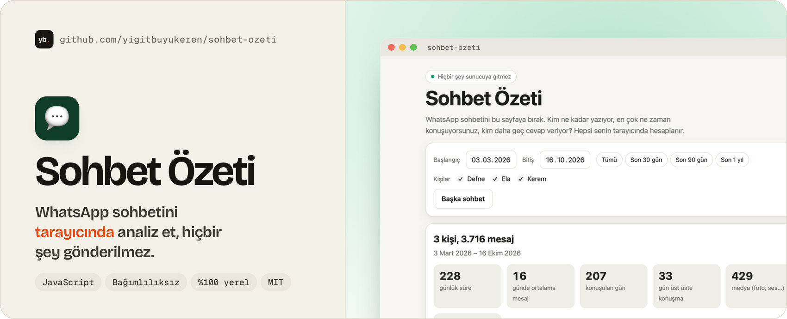
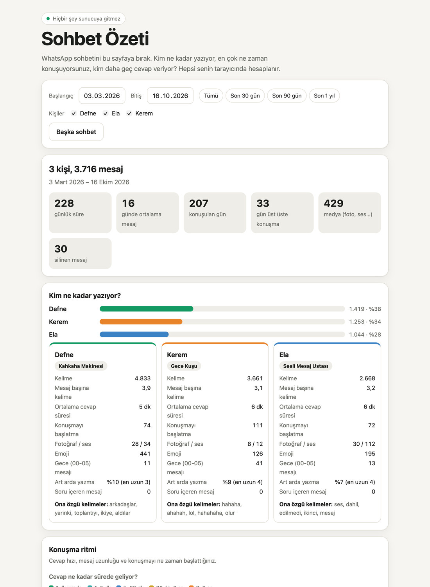

<a href="https://github.com/yigitbuyukeren/sohbet-ozeti#-nasıl-kullanılır">
  <picture>
    <source media="(prefers-color-scheme: dark)" srcset="docs/banner-dark.jpg">
    
  </picture>
</a>

<div align="center">

**[🌐 Canlı demo](https://yigitbuyukeren.github.io/sohbet-ozeti/)** &nbsp;·&nbsp; **[🚀 Nasıl kullanılır](#-nasıl-kullanılır)** &nbsp;·&nbsp; **[📊 Neler çıkıyor](#-neler-çıkıyor)** &nbsp;·&nbsp; **[🐞 Sorun bildir](https://github.com/yigitbuyukeren/sohbet-ozeti/issues)**

[](LICENSE)


[](https://github.com/yigitbuyukeren/sohbet-ozeti/actions)

🇹🇷 [Türkçe](#-türkçe) &nbsp;·&nbsp; 🇬🇧 [English](#-english)

</div>

<details open>
<summary><h2>🇹🇷 Türkçe</h2></summary>

Dışa aktardığın WhatsApp sohbet dosyasını (`.txt` ya da `.zip`) sayfaya bırakırsın, tarayıcın analiz eder ve sonucu gösterir. **Sunucu, hesap, yükleme yok; sohbetin cihazından çıkmaz.**

<p align="center">
  <picture>
    <source media="(prefers-color-scheme: dark)" srcset="docs/ekran-dark.jpg">
    
  </picture>
</p>

<p align="center"><sub>Ekran görüntüsündeki sohbet uydurmadır (örnek sohbet düğmesi).</sub></p>

| 🔒 **%100 yerel** | 📊 **Zengin özet** | 🖼️ **Paylaşılabilir** | 🧩 **Bağımlılıksız** |
|:---:|:---:|:---:|:---:|
| Sayfa ağa bağlanamaz, güvenlik politikasıyla kilitli | Yoğunluk haritası, cevap süresi, kelimeler, emojiler | Hikâye boyutunda görsel, içinde mesaj yok | Saf JavaScript, kütüphane yok |

### 🚀 Nasıl kullanılır
1. 📱 WhatsApp'ta sohbeti aç → **Sohbeti dışa aktar** → **Medyasız**.
2. 🌐 [Canlı demoyu](https://yigitbuyukeren.github.io/sohbet-ozeti/) aç (ya da aşağıdaki gibi kendi bilgisayarında çalıştır) ve dosyayı üstüne bırak. İstersen önce **Örnek sohbetle dene** düğmesine bas.
3. 🖼️ Beğendiğin özeti **PNG** olarak indir.

Sayfayı kendi bilgisayarında açmak için:

```bash
python3 -m http.server 8000
```

Sonra tarayıcıda `http://localhost:8000` adresini aç. (`index.html`'e çift tıklamak da çoğu tarayıcıda çalışır; bazıları dosya kaynaklı sayfalarda güvenlik politikasını farklı uygular.)

### 📊 Neler çıkıyor
- **Özet:** toplam mesaj, gün sayısı, günde ortalama, art arda konuşulan gün serisi, medya ve silinen mesajlar
- **Kişi kartları:** mesaj payı, kelime, mesaj başına kelime, **medyan cevap süresi**, konuşmayı başlatma, art arda yazma oranı, ona özgü kelimeler, eğlenceli unvanlar (*Gece Kuşu, Kahkaha Makinesi, Roman Yazarı…*)
- **Konuşma ritmi:** cevap süresi dağılımı (1 dk içinde → 6 saate), mesaj uzunluğu dağılımı, yeni konuşmanın başladığı saat
- **Isı haritası** (haftanın günü × saat) ve **zaman çizgisi** (aylık ve haftalık, en yoğun ve en sessiz hafta)
- **Sık söylenenler:** sevgi, teşekkür, özür, selamlaşma ve kahkaha sayıları
- **Kelimeler:** en sık kelimeler, ikili kelime öbekleri, emojiler, paylaşılan bağlantıların alan adları
- **Duygu dengesi** (eğlence amaçlı): küçük bir Türkçe sözlükle olumlu/olumsuz oranı ve aylık seyri
- **Kim kime cevap veriyor?** ağı (3 kişi ve üzeri gruplarda)
- **Filtreler:** tarih aralığı (hazır: son 30 gün, 90 gün, 1 yıl) ve kişi seçimi; her şey yeniden hesaplanır
- **Dışa aktarma:** iki hikâye boyutlu görsel (özet ve ritim kartı), **JSON** ve **CSV**. Görsellerde mesaj içeriği yok, JSON/CSV yalnızca istatistik taşır.

### 🔧 Nasıl çalışıyor
- **Ayrıştırıcı** ([`src/parser.js`](src/parser.js)): Android (`24.10.2026 14:32 - Ali: …`) ve iOS (`[24.10.26 14:32:05] Ali: …`) biçimlerini, 12/24 saati ve gün/ay sırasını kendisi ayırt eder. Gün/ay sırası tüm dosyadaki 12'den büyük sayılara bakılarak seçilir, belirsizse Türkçe düzen (gün önce) varsayılır. Çok satırlı mesajları birleştirir; medya, silinen ve sistem mesajlarını ayırır.
- **Zip okuyucu** ([`src/zip.js`](src/zip.js)): `.zip` içindeki sohbeti, tarayıcının `DecompressionStream`'i ile açar; kütüphane gerekmez.
- **İstatistikler** ([`src/stats.js`](src/stats.js)) ve **ayrıntılı analiz** ([`src/derin.js`](src/derin.js), [`src/duygu.js`](src/duygu.js)): DOM'a dokunmayan saf fonksiyonlar, bu yüzden Node ile test edilir.
- **Art arda yazma:** aynı kişinin 10 dakika içindeki mesajları tek "tur" sayılır; birden çok mesajlı turların oranı çıkar.
- **Ona özgü kelimeler:** bir kişinin diğerlerine göre fazladan kullandığı kelimeler, log-oran puanıyla seçilir (en az 3 kez geçenler).
- **Duygu:** sözlük kökleri, basit olumsuzlama ("iyi değil") ve emojilerle kaba bir puan; ironiyi ve bağlamı anlamaz, bu yüzden arayüzde "eğlence amaçlı" diye işaretlidir.
- **Cevap süresi:** konuşan kişi değiştiğinde ve aradaki süre 6 saatten kısaysa ölçülür; ortalama yerine **medyan** alınır, bir kez uzun beklemek sonucu bozmaz. 6 saatten uzun sessizlikten sonraki mesaj yeni bir konuşma sayılır.
- **Grafikler** elle yazılmış SVG; paylaşım görseli canvas ile çizilir.

### 🔒 Gizlilik
- `index.html` bir **içerik güvenlik politikası** taşır (`connect-src 'none'`): sayfa, sen istesen bile dışarıya istek atamaz.
- Hiçbir analitik, font ya da CDN yoktur; her şey bu depodaki dosyalardan yüklenir.
- Analizden sonra sayfa, bu sırada yapılan ağ isteği sayısını gösterir (olması gereken: 0).
- Örnek sohbet ve testlerdeki veriler uydurmadır; gerçek bir sohbet depoda bulunmaz.

### 🛠️ Geliştirme
```bash
npm test        # node --test, bağımlılık kurmak gerekmez (Node 18+)
```
Testler ayrıştırıcıyı (iki biçim, 12/24 saat, belirsiz tarih, çok satır, medya, altyazı), zip okuyucuyu, istatistikleri ve ayrıntılı analizi (cevap kutuları, çift mesaj, ifadeler, bağlantılar, haftalık seri, duygu) kapsar.

### 📜 Lisans
[MIT](LICENSE): kullanabilir, değiştirebilir, dağıtabilirsin. ⭐ İşine yaradıysa yıldız vermeyi unutma!

</details>

<details>
<summary><h2>🇬🇧 English</h2></summary>

Drop an exported WhatsApp chat (`.txt` or `.zip`) on the page and your browser turns it into a summary: who writes how much, when you talk, who replies slowly. **No server, no account, no upload; the chat never leaves your device.** The interface is in Turkish.

**What you get:** message totals and streaks, per-person share, words per message and median reply time, reply-time and message-length distributions, double-texting rate, a weekday × hour heatmap, monthly and weekly timelines, phrase counters (love, thanks, sorry…), top words, word pairs and distinctive words per person, shared link domains, a rough lexicon-based sentiment balance, a who-replies-to-whom matrix for groups, and playful titles. Filter by date range and people. Download two story-sized PNG cards (numbers only, no message text), plus JSON and CSV with statistics only.

**Run it:** open the [live demo](https://yigitbuyukeren.github.io/sohbet-ozeti/), or `python3 -m http.server 8000`, then open `http://localhost:8000`. Try **"Örnek sohbetle dene"** for a fake demo chat.

**How it works:** a parser for the Android and iOS export formats (12/24-hour clocks, day/month order inferred from the data, multi-line messages), a dependency-free zip reader built on `DecompressionStream`, and a pure statistics module covered by `node --test`. Charts are hand-written SVG.

**Privacy:** `index.html` ships a Content-Security-Policy with `connect-src 'none'`, so the page cannot make network requests. No analytics, fonts or CDNs. After analysis the page shows the number of requests made during it (expected: 0).

Run the tests with `npm test` (Node 18+, nothing to install). Released under the [MIT License](LICENSE).

</details>
